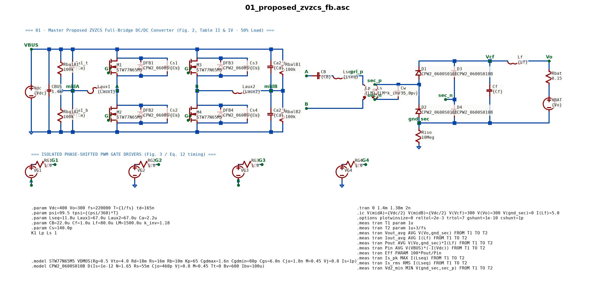
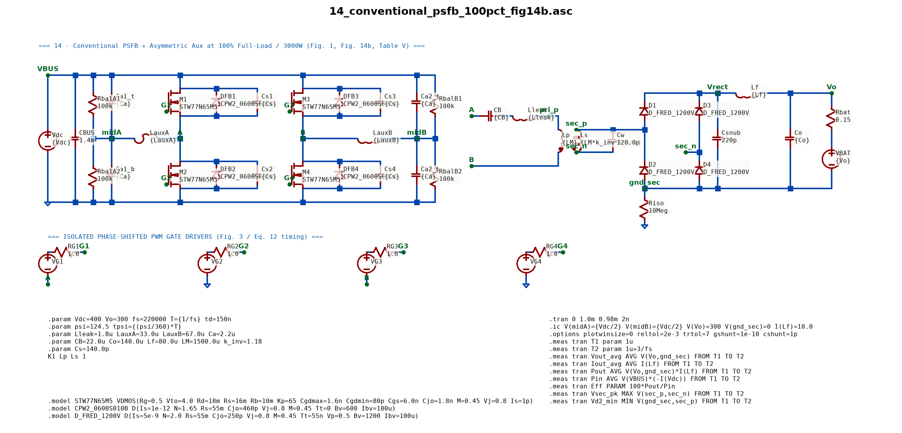

# Relazione Tecnica, Replica LTspice Completa e Analisi Critica

**Articolo analizzato:**
M. Pahlevaninezhad, P. Das, J. Drobnik, P. K. Jain, and A. Bakhshai, *"A Novel ZVZCS Full-Bridge DC/DC Converter Used for Electric Vehicles"*, **IEEE Transactions on Power Electronics**, Vol. 27, No. 6, pp. 2752–2769, Giugno 2012 ([35.pdf](35.pdf)).

---

## Indice

1. [Contesto Applicativo e Limiti del Full-Bridge Convenzionale](#1-contesto-applicativo-e-limiti-del-full-bridge-convenzionale)
2. [Architettura della Topologia Proposta e Modi di Funzionamento (Modi I–VII)](#2-architettura-della-topologia-proposta-e-modi-di-funzionamento-modi-ivii)
3. [Analisi Stazionaria e Procedura di Progetto (con Formule Corrette)](#3-analisi-stazionaria-e-procedura-di-progetto-con-formule-corrette)
4. [Modellazione in LTspice e Replica Completa di Tutte le Figure del Paper](#4-modellazione-in-ltspice-e-replica-completa-di-tutte-le-figure-del-paper)
5. [Audit Critico Completo: Errori Matematici, Dimensionali, Progettuali e Incongruenze Sperimentali in `35.pdf`](#5-audit-critico-completo-errori-matematici-dimensionali-progettuali-e-incongruenze-sperimentali-in-35pdf)
6. [Guida alla Presentazione Orale (Scaletta 30 e Lode + Domande Frequenti)](#6-guida-alla-presentazione-orale-scaletta-30-e-lode--domande-frequenti)

---

## 1. Contesto Applicativo e Limiti del Full-Bridge Convenzionale

L'articolo propone un convertitore DC/DC isolato **Full-Bridge ZVZCS** da **3 kW** operante a **220 kHz**, concepito come secondo stadio di un caricabatterie di bordo (*on-board plug-in charger*) per veicoli elettrici (EV) destinato alla ricarica della batteria di trazione ad alta tensione (**235–431 VDC**, nominale di test dichiarato **300 VDC**) a partire dal bus DC intermedio (**400 VDC**) generato da uno stadio PFC Boost Interleaved a due fasi (50 kHz, 170–267 VAC, capacità di bus $C_{BUS} = 1.4\text{ mF}$, controllato da DSP `TMX320F28335`, Fig. 12 del paper).

### Perché il Full-Bridge Phase-Shift Convenzionale (PSFB, Fig. 1) fallisce in questa applicazione

Un caricabatterie EV deve lavorare in modo affidabile **dal 100% di carico fino a carico rigorosamente nullo (0% / no-load)** (quando la batteria raggiunge la carica completa). Il PSFB convenzionale (Fig. 1, con raddrizzatore **voltage-driven** seguito immediatamente da $L_f$) soffre di tre problemi strutturali gravi, riprodotti integralmente nei nostri schemi [`13_conventional_psfb_10pct_fig14a.asc`](ltspice/13_conventional_psfb_10pct_fig14a.asc) e [`14_conventional_psfb_100pct_fig14b.asc`](ltspice/14_conventional_psfb_100pct_fig14b.asc):

1. **Sovratensioni distruttive sui diodi del raddrizzatore d'uscita**: l'induttanza di dispersione $L_{leak}$ del trasformatore ($1.8\,\mu\text{H}$, Tabella V) e l'induttore di filtro d'uscita $L_f$ ($80\,\mu\text{H}$) si comportano come **due generatori di corrente connessi in serie** attraverso il ponte a diodi. A ogni commutazione dei diodi (aggravata dalla carica di recupero inverso $Q_{rr}$ e dalle capacità parassite secondarie $C_w, C_j$), si generano picchi di tensione oscillanti ben oltre i **600–960 V** (per una tensione d'uscita di soli 300 V!), obbligando all'uso di diodi da **1200 V** (maggiore $V_F$, maggiore $Q_{rr}$) e snubber R-C-D fortemente dissipativi.
2. **Perdita di ZVS a basso carico**: usando la sola $L_{leak}$ per scaricare le capacità parassite $C_{oss}$ dei MOSFET, al diminuire del carico l'energia $\frac{1}{2}L_{leak}I_p^2$ non basta più per ottenere lo ZVS. Nel confronto sperimentale (Tabella V), gli autori aggiungono al PSFB convenzionale un **circuito ausiliario asimmetrico** ($L_{AUX,A} = 33\,\mu\text{H}$ sulla gamba leading, $L_{AUX,B} = 67\,\mu\text{H}$ sulla gamba lagging), perché sulla gamba leading la corrente ausiliaria deve anche compensare la corrente di dispersione negativa: ciò raddoppia la corrente circolante e quadruplica le perdite di conduzione nel ramo ausiliario leading.
3. **Intervallo di freewheeling e perdita di duty-cycle**: durante l'intervallo a tensione nulla dell'inverter ($v_{AB}=0$), la corrente riflessa del carico continua a ricircolare nel primario e nei diodi secondari (freewheeling), generando alte perdite di conduzione e un gradino di ritardo (*duty-cycle loss*) sul fronte di salita della tensione secondaria (ben visibile in [`fig14_conventional_fb_10_100pct.png`](figures/fig14_conventional_fb_10_100pct.png)).

---

## 2. Architettura della Topologia Proposta e Modi di Funzionamento (Modi I–VII)

### Le due innovazioni chiave della topologia proposta (Fig. 2)

1. **Raddrizzatore *current-driven* con induttore serie integrato ($L_{seq}$) e condensatore di clamping ($C_f$) direttamente a valle del ponte a diodi**:
   - L'induttore $L_{seq} = L_s + L_{leak} = 11.8\,\mu\text{H}$ (integrato direttamente nella dispersione del trasformatore tramite spaziatura assiale $c$ tra gli avvolgimenti *top-bottom*, Fig. 10) trasforma il primario in una sorgente di corrente impulsiva operante in **DCM (Discontinuous Conduction Mode)** fino al limite di pieno carico.
   - Il condensatore $C_f = 1\,\mu\text{F}$ posto **immediatamente** ai capi del ponte a diodi $D_1\text{–}D_4$ (e **prima** di $L_f = 80\,\mu\text{H}$) fissa rigidamente la tensione di blocco di ciascun diodo a **$V_o$ (300 V)**, eliminando fisicamente qualsiasi sovratensione (consentendo l'uso di diodi SiC Schottky da **600 V**, `CPW2-0600S010B`, a recupero inverso nullo!).
   - Quando $i_s$ si annulla naturalmente in DCM, i diodi d'uscita si spengono in **ZCS naturale**, il modo di freewheeling viene **completamente eliminato** e i MOSFET della gamba *leading* commutano in **ZVZCS** (tensione nulla e corrente di carico nulla).
2. **Circuito ausiliario passivo simmetrico ($L_{AUX1} = L_{AUX2} = 67\,\mu\text{H}$, $C_{a1} = C_{a2} = 2.2\,\mu\text{F}$)**:
   - Poiché all'accensione della gamba *leading* ($S_1, S_2$) in DCM la corrente primaria $i_s$ parte da **zero**, non serve compensare alcuna corrente primaria negativa: entrambi i rami ausiliari sono **identici e simmetrici**, portano solo la piccola corrente reattiva triangolare ($I_{PA} = I_{PB} = 3.39\text{ A}$ picco, $1.96\text{ A}_{\text{rms}}$) sufficiente a caricare/scaricare le capacità $C_{oss}+C_s$ durante il tempo morto $t_d$, garantendo **ZVS dal 100% fino allo 0% (no-load)**.

### Specifiche e Componenti del Prototipo (Tabelle I, II, IV e V)

| Parametro | Simbolo | Topologia Proposta (Tab. I–II–IV) | PSFB Convenzionale (Tab. V) | Note / Osservazioni |
| :--- | :---: | :---: | :---: | :--- |
| Potenza nominale | $P_o$ | $3\text{ kW}$ | $3\text{ kW}$ | — |
| Tensione bus DC | $V_{dc}$ | $400\text{ VDC}$ | $400\text{ VDC}$ | Da PFC 170–267 VAC ($C_{BUS}=1.4\text{ mF}$) |
| Tensione batteria | $V_o$ | $235\text{–}431\text{ VDC}$ (test: $300\text{ V}$) | $300\text{ VDC}$ | Negli oscillogrammi Figg. 16–20 è in realtà $\approx 355\text{ V}$! |
| Frequenza di switching | $f_s$ | $220\text{ kHz}$ ($T_s = 4.545\,\mu\text{s}$) | $220\text{ kHz}$ | Fig. 14 catturata a $\approx 150\text{ kHz}$! |
| Rapporto spire ($N_p:N_s$) | $k = N_p/N_s$ | $1:1.18$ ($k = 0.8475$) | $1:1.18$ ($k = 0.8475$) | Elevatore per raggiungere $431\text{ V}$ |
| Induttore serie / dispersione | $L_{seq}$ / $L_{leak}$ | $11.8\,\mu\text{H}$ ($12.6\text{ A}_{\text{rms}}$) | $1.8\,\mu\text{H}$ | Integrato nel trasformatore |
| Induttori ausiliari | $L_{AUX1}, L_{AUX2}$ | $67\,\mu\text{H},\; 67\,\mu\text{H}$ (simmetrici) | $33\,\mu\text{H},\; 67\,\mu\text{H}$ (asimmetrici) | Rating $2\text{ A}_{\text{rms}}$ |
| Capacità partitori ausiliari | $C_{a1}, C_{a2}$ | $2.2\,\mu\text{F}$ ($300\text{ VDC}$) | $2.2\,\mu\text{F}$ | Punto medio a $V_{dc}/2 = 200\text{ V}$ |
| Condensatore d'uscita | $C_f$ / $C_o$ | $1\,\mu\text{F}$ (clamping, **prima** di $L_f$) | $140\,\mu\text{F}$ (filtro, **dopo** $L_f$) | Differenza topologica fondamentale |
| Induttore filtro d'uscita | $L_f$ | $80\,\mu\text{H}$ ($10\text{ A}_{\text{DC}}$) | $80\,\mu\text{H}$ | — |
| MOSFET Full-Bridge | $S_1\text{–}S_4$ | `STW77N65M5` (650 V, 65 A, $33\text{ m}\Omega$) | `STW77N65M5` | + diodi SiC in parallelo (`CPW2-0600S010B`) |
| Driver di gate | $DR$ | `UCC27322D` ($9\text{ A}$ picco) | `UCC27322D` | Riduce perdite di turn-off |
| Diodi raddrizzatore d'uscita | $D_1\text{–}D_4$ | `CPW2-0600S010B` (600 V, 10 A SiC) | 1200 V Fast-Recovery Si | In Tab. IV erroneamente chiamati `D_PFC` |
| Parametri omessi in Tab. II | $C_B, L_M, t_d$ | Non riportati nel paper | Non riportati | Scelti fisicamente: $C_B=22\,\mu\text{F}$, $L_M=1.5\text{ mH}$, $t_d=165\text{ ns}$ |

### I 7 Modi di Funzionamento nel Semiperiodo Positivo (Fig. 3 e Fig. 4)

In un periodo completo $T_s = 4.545\,\mu\text{s}$ il convertitore attraversa **14 modi** (7 simmetrici per semiperiodo). I nostri schemi [`02_proposed_ideal_modes_fig3.asc`](ltspice/02_proposed_ideal_modes_fig3.asc) e la figura [`fig03_ideal_waveforms_modes.png`](figures/fig03_ideal_waveforms_modes.png) mostrano esattamente tutte le 7 fasi:

- **Modo I ($t_0 \le t \le t_1$) — Transizione *leading* prima della conduzione dei diodi**: a $t_0$ si spegne $S_2$ (mentre $S_4$ è ON e $i_s = 0$). La corrente reattiva $I_{PA} \approx 3.39\text{ A}$ dell'induttore ausiliario $L_{AUX1}$ scarica $C_{s1}$ e carica $C_{s2}$, facendo salire linearmente $v_{AB}(t) = \frac{I_{PA}}{2C_{so}}(t - t_0)$. I diodi secondari sono ancora interdetti, per cui la piccolissima corrente primaria fluisce attraverso $L_{seq} + L_M$. Termina a $t_1$ quando $v_{sec}$ raggiunge $V_o + 2V_d$.
- **Modo II ($t_1 \le t \le t_2$) — Inizio conduzione diodi e completamento ZVS *leading***: i diodi d'uscita entrano in conduzione e clampano $v_{sec} = V_o + 2V_d$. $C_{s1}$ finisce di scaricarsi fino a $0\text{ V}$ a $t_2 = t_0 + \frac{2V_{dc}C_{so}}{I_{PA}}$; il diodo parallelo di $S_1$ entra in conduzione consentendo l'accensione di $S_1$ a **tensione nulla (ZVS)** e con corrente di carico praticamente nulla (**near-ZCS**).
- **Modo III ($t_2 \le t \le t_3$) — Trasferimento attivo di energia**: $S_1$ e $S_4$ sono entrambi in conduzione ($v_{AB} = +V_{dc}$). Ai capi di $L_{seq}$ è applicata la tensione costante $V_{dc} - k(V_o + 2V_d) \approx +143.2\text{ V}$, quindi $i_s(t)$ cresce linearmente con pendenza $\approx +12.1\text{ A}/\mu\text{s}$ fino al picco $I_p$ a $t_3$ (quando $S_4$ viene spento). La durata attiva è $t_{on} = t_3 - t_2 = \frac{\psi}{\omega_s} - t_d$.
- **Modo IV ($t_3 \le t \le t_4$) — Transizione *lagging* risonante**: spento $S_4$, la somma $I_p + I_{PB}$ scarica rapidamente $C_{s3}$ e carica $C_{s4}$, portando $v_{AB}$ da $+V_{dc}$ a $0\text{ V}$. A carichi ultra-leggeri ($I_p < 1.8\text{ A}$, cioè $P_o < 50\text{ W}$, $< 1.7\%$ del carico nominale), la corrente primaria $i_s(t)$ si annulla all'istante intermedio $t_{3-4} \in (t_3, t_4)$ prima che $v_{AB}$ raggiunga zero, generando la caratteristica transizione a **due pendenze** dei sottomodi IV-a ($-\frac{i_s(t)+I_{PB}}{2C_{so}}$) e IV-b ($-\frac{I_{PB}}{2C_{so}}$) illustrata in Fig. 5 e replicata in [`fig05_mode4_light_load_submodes.png`](figures/fig05_mode4_light_load_submodes.png) insieme al caso al 10% di carico ($300\text{ W}$, dove $I_p = 6.6\text{ A}$ scarica $2C_{so}$ in soli $52\text{ ns}$ con singola pendenza).
- **Modo V ($t_4 \le t \le t_5$) — Tempo morto *lagging* (conduzione diodo di $S_3$)**: raggiunta $v_{AB} = 0$, il diodo in antiparallelo a $S_3$ conduce. Poiché il secondario è ancora clampato a $V_o$, su $L_{seq}$ insiste la tensione negativa $-k(V_o + 2V_d) \approx -256.8\text{ V}$ e $i_s$ decresce rapidamente con pendenza $\approx -21.8\text{ A}/\mu\text{s}$.
- **Modo VI ($t_5 \le t \le t_6$) — Accensione ZVS di $S_3$ e smagnetizzazione di $L_{seq}$**: si applica il comando di gate a $S_3$ in **pieno ZVS** ($V_{DS} < 0$). $i_s$ prosegue la rampa discendente fino ad annullarsi a $t_6$, momento in cui i diodi d'uscita si spengono **naturalmente a corrente nulla (ZCS)** senza alcun recupero inverso.
- **Modo VII ($t_6 \le t \le t_7$) — Intervallo discontinuo (DCM)**: $i_s = 0$, tutti i diodi d'uscita sono interdetti (con tensione che oscilla smorzata attorno a $-V_o/2$ per risonanza tra $L_{seq}/k^2$ e $C_w + C_j$ a $\approx 4.7\text{ MHz}$), mentre $C_f$ sostiene la corrente in $L_f$ verso la batteria. Questo azzera le correnti di ricircolo e prepara l'accensione **ZVZCS** di $S_2$ nel semiperiodo successivo.

---

## 3. Analisi Stazionaria e Procedura di Progetto (con Formule Corrette)

Come dimostrato dettagliatamente nella [Sezione 5](#5-audit-critico-completo-errori-matematici-dimensionali-progettuali-e-incongruenze-sperimentali-in-35pdf), numerose equazioni analitiche nel paper presentano errori di segno, di fattore numerico o dimensionali. Qui si riportano le **espressioni fisicamente corrette** verificate in LTspice:

### 3.1 Guadagno di tensione stazionario in DCM

Con $t_{on} = \frac{\psi}{\omega_s} - t_d$, $k = N_p/N_s = 1/1.18$ e $L_{seq} = L_s + L_{leak}$:
- Tempo di smagnetizzazione in DCM: $t_{off} = t_{on} \frac{V_{dc} - k V_o}{k V_o}$, dunque durata totale triangolo $t_{on}+t_{off} = t_{on}\frac{V_{dc}}{k V_o}$.
- Corrente media raddrizzata primaria **corretta** (il paper Eq. (16) ha un fattore $2/T_s$ errato):
  $$I = \frac{1}{T_s} \left(\frac{\psi}{\omega_s} - t_d\right)^2 \left(\frac{V_{dc}}{k V_o}\right) \left(\frac{V_{dc} - k V_o}{L_{seq}}\right)$$
- Dal bilancio di potenza $k I V_o = \frac{V_o^2}{R_e}$, il guadagno di tensione **corretto e dimensionalmente coerente** (il paper Eq. (18) pone erroneamente $T_s$ al denominatore!) è:
  $$g_v = \frac{V_o}{V_{dc}} = \frac{2}{k + \sqrt{k^2 + \dfrac{4 \, T_s \, L_{seq}}{R_e \left(\dfrac{\psi}{\omega_s} - t_d\right)^2}}}$$
- Questa equazione vale **solo in DCM**, cioè finché $t_{on} + t_{off} \le T_s/2 \iff \left(\frac{\psi}{\omega_s} - t_d\right) \le \frac{k V_o}{V_{dc}}\frac{T_s}{2}$. Oltre tale soglia il convertitore entra in **CCM**, dove il guadagno satura (si veda [`fig07_converter_gain_comparison.png`](figures/fig07_converter_gain_comparison.png)).

### 3.2 Progetto degli induttori ausiliari ($L_{AUX1} = L_{AUX2}$)

La corrente triangolare di picco (Eq. (20), **corretta** nel paper) vale:
$$I_{PA} = I_{PB} = \frac{V_{dc}}{8 \, L_{AUX} \, f_s} = \frac{400}{8 \cdot 67\,\mu\text{H} \cdot 220\text{ kHz}} = 3.39\text{ A} \implies I_{AUX,\text{rms}} = \frac{I_{PA}}{\sqrt{3}} = 1.96\text{ A}$$
Valore perfettamente compatibile con il rating $2\text{ A}_{\text{rms}}$ di Tabella II. Con una capacità effettiva di commutazione per interruttore $C_{so} \approx 550\text{–}650\text{ pF}$ (`STW77N65M5` + `CPW2-0600S010B` + $C_s$), il tempo di transizione a vuoto è $t_r = \frac{2 C_{so} V_{dc}}{I_{PA}} \approx 130\text{–}150\text{ ns} < t_d = 165\text{ ns}$, garantendo **ZVS completo anche allo 0% di carico**.

### 3.3 Progetto dell'induttore serie $L_{seq}$ in Critical Conduction Mode (BCM)

Imponendo il limite BCM a pieno carico ($t_{on} + t_{off} = T_s/2 \implies t_{on} = \frac{k V_o}{V_{dc}}\frac{T_s}{2}$) e ricordando che la corrente media primaria è $I_o / k$ (quindi il picco primario è $I_p = 2 I_o / k$, **non** $2 k I_o$ come in Fig. 9!):
$$L_{seq,\text{BCM}} = \frac{k^2 \, V_o^2}{4 \, P_{o,\max}} \left(1 - k \frac{V_o}{V_{dc}}\right) T_s$$
- A $V_{dc} = 400\text{ V}$, $V_o = 300\text{ V}$, $P_{o,\max} = 3000\text{ W}$, $f_s = 220\text{ kHz}$:
  - Formula corretta ideale: **$L_{seq,\text{BCM}} = 8.92\,\mu\text{H}$** (includendo le cadute dei diodi $2V_d \approx 3\text{ V}$, il tempo morto $t_d$ e le resistenze parassite: **$L_{seq,\text{BCM,pratico}} \approx 8.0\,\mu\text{H}$**, che in LTspice a $\psi = 119.5^\circ$ eroga esattamente i **$3.0\text{–}3.1\text{ kW}$ ($I_o \approx 10\text{ A}$, $I_p = 2I_o/k \approx 23.6\text{–}25.1\text{ A}$) in vero regime BCM**).
  - Formula errata del paper Eq. (26): $3.48\,\mu\text{H}$.
  - Valore di prototipo Tabella II: **$11.8\,\mu\text{H}$** $\implies$ porta il BCM già a **$2.27\text{ kW}$ (75% di carico)** e costringe il convertitore in **CCM profondo a 3 kW**!

### 3.4 Progetto del condensatore di clamping $C_f$

In BCM, la corrente nel condensatore $i_{Cf} = i_{DB} - I_o$ è una triangolare simmetrica tra $-I_o$ e $+I_o$, per cui l'Eq. (32) del paper è **esatta**:
$$C_f = \frac{I_o}{8 \, f_s \, \Delta V_{Cf}}$$
Con $C_f = 1\,\mu\text{F}$ e $I_o = 10\text{ A}$ si ottiene $\Delta V_{Cf} = \frac{10}{8 \cdot 220\text{k} \cdot 1\mu} = 5.68\text{ V}$ ($1.89\%$ di $300\text{ V}$), confermato con estrema precisione in [`fig11_output_capacitor_waveforms.png`](figures/fig11_output_capacitor_waveforms.png).

---

## 4. Modellazione in LTspice e Replica Completa di Tutte le Figure del Paper

Tutti i **17 circuiti** nella cartella [`ltspice/`](ltspice/) sono stati generati su griglia rigorosa da 16 px, verificati geometricamente tramite [`scripts/asc_compiler.py`](scripts/asc_compiler.py) (zero pin flottanti, zero corti accidentali), corredati di file `.plt` e simulati nativamente in **LTspice 17.2.4 per macOS** utilizzando modelli SPICE calibrati sui datasheet reali di Tabella IV (`STW77N65M5` VDMOS con driver `UCC27322D` da 9 A, diodi SiC `CPW2_0600S010B` a $T_t = 0$, e diodi Si `D_FRED_1200V` da 1200 V con $T_t = 55\text{ ns}$ per il confronto convenzionale).

### Anteprima degli Schematici LTspice

### Tabella Riassuntiva di Tutte le 17 Simulazioni LTspice Eseguite

| File LTspice (`.asc` + `.plt`) | Figura Paper | Condizione di Test | $P_o$ (LTspice) | $I_{s,\text{pk}}$ | $V_{D2,\min}$ / $V_{sec,\text{pk}}$ | $\eta$ (LTspice) | Figura Replicata |
| :--- | :---: | :--- | :---: | :---: | :---: | :---: | :--- |
| [`01_proposed_zvzcs_fb.asc`](ltspice/01_proposed_zvzcs_fb.asc) | Fig. 2 | Master 50% ($\psi=99.5^\circ$) | $1524.7\text{ W}$ | $14.50\text{ A}$ | $-305.1\text{ V}$ | $97.65\%$ | Schema master |
| [`02_proposed_ideal_modes_fig3.asc`](ltspice/02_proposed_ideal_modes_fig3.asc) | Figg. 3, 6, 8, 11a | 50% DCM ideale (12 tracce, $1\text{ ns}$) | $1441.8\text{ W}$ | $14.21\text{ A}$ | $-304.7\text{ V}$ | $96.26\%$ | [Fig. 3](figures/fig03_ideal_waveforms_modes.png), [Fig. 6](figures/fig06_series_inductor_vi.png), [Fig. 8](figures/fig08_auxiliary_circuit_waveforms.png), [Fig. 11](figures/fig11_output_capacitor_waveforms.png) |
| [`02_proposed_ideal_modes_fig3.asc`](ltspice/02_proposed_ideal_modes_fig3.asc) | Figg. 3, 6, 8, 11a | 50% DCM reale alta ris. (12 tracce, $1\text{ ns}$) | $1525.2\text{ W}$ | $14.50\text{ A}$ | $-305.1\text{ V}$ | $97.65\%$ | [Fig. 3](figures/fig03_ideal_waveforms_modes.png), [Fig. 6](figures/fig06_series_inductor_vi.png), [Fig. 8](figures/fig08_auxiliary_circuit_waveforms.png), [Fig. 11](figures/fig11_output_capacitor_waveforms.png) |
| [`03_proposed_gain_sweep_fig7.asc`](ltspice/03_proposed_gain_sweep_fig7.asc) | Fig. 7 | Sweep 2D ($7\,R_e \times 12\,\psi = 84$ pt) | $g_v \in [0.125, 1.136]$ | — | — | — | [Fig. 7](figures/fig07_converter_gain_comparison.png) |
| [`04_proposed_bcm_design_fig9.asc`](ltspice/04_proposed_bcm_design_fig9.asc) | Figg. 9, 11b | BCM: $11.8\,\mu\text{H}$ vs $8.0\,\mu\text{H}$ (3 kW) | $2126\text{ W}$ / $3114\text{ W}$ | $17.1\text{ A}$ / $25.1\text{ A}$ | $-305.5\text{ V}$ / $-307.5\text{ V}$ | $97.9\%$ / $97.4\%$ | [Fig. 9](figures/fig09_critical_conduction_mode.png), [Fig. 11](figures/fig11_output_capacitor_waveforms.png) |
| [`05_proposed_noload_fig15.asc`](ltspice/05_proposed_noload_fig15.asc) | Fig. 15 | 0% No-Load ($\psi=13.5^\circ$) | $23.9\text{ W}$ ($\approx 0\%$) | $1.70\text{ A}$ | $-301.2\text{ V}$ | — | [Fig. 15](figures/fig15_proposed_noload.png) |
| [`06_proposed_load_10pct_fig16.asc`](ltspice/06_proposed_load_10pct_fig16.asc) | Figg. 16, 5 | 10% Load ($\psi=44.8^\circ$) | $324.3\text{ W}$ | $6.62\text{ A}$ | $-302.4\text{ V}$ | $97.50\%$ | [Fig. 16](figures/fig16_proposed_10pct.png), [Fig. 5](figures/fig05_mode4_light_load_submodes.png) |
| [`07_proposed_load_25pct_fig17.asc`](ltspice/07_proposed_load_25pct_fig17.asc) | Fig. 17a, b | 25% Load ($\psi=71.0^\circ$) | $857.0\text{ W}$ | $10.88\text{ A}$ | $-303.7\text{ V}$ | $98.04\%$ | [Fig. 17](figures/fig17_proposed_25pct_full_and_zoom.png) |
| [`08_proposed_load_50pct_fig18.asc`](ltspice/08_proposed_load_50pct_fig18.asc) | Fig. 18a, b | 50% Load ($\psi=99.5^\circ$) | $1524.7\text{ W}$ | $14.50\text{ A}$ | $-305.1\text{ V}$ | $97.65\%$ | [Fig. 18](figures/fig18_proposed_50pct_full_and_zoom.png) |
| [`09_proposed_load_70pct_fig19.asc`](ltspice/09_proposed_load_70pct_fig19.asc) | Fig. 19a, b | 70% Load ($\psi=116.5^\circ$) | $2028.2\text{ W}$ | $16.68\text{ A}$ | $-305.4\text{ V}$ | $97.95\%$ | [Fig. 19](figures/fig19_proposed_70pct_full_and_zoom.png) |
| [`10_proposed_load_85pct_fig20.asc`](ltspice/10_proposed_load_85pct_fig20.asc) | Fig. 20a, b | 85% Load ($\psi=123.5^\circ$, CCM) | $2616.7\text{ W}$ | $19.04\text{ A}$ | $-305.9\text{ V}$ | $97.77\%$ | [Fig. 20](figures/fig20_proposed_85pct_full_and_zoom.png) |
| [`11_proposed_load_100pct_fig21.asc`](ltspice/11_proposed_load_100pct_fig21.asc) | Fig. 21 | 100% Load ($\psi=151^\circ$, **CCM**) | $3002.8\text{ W}$ | $21.17\text{ A}$ | $-306.8\text{ V}$ | $97.59\%$ | [Fig. 21](figures/fig21_proposed_100pct_ccm_vs_bcm.png) |
| [`12_proposed_aux_circuit_fig22.asc`](ltspice/12_proposed_aux_circuit_fig22.asc) | Fig. 22a, b | Corrente aux a 12% e 100% | $379\text{ W}$ / $3003\text{ W}$ | $7.2\text{ A}$ / $21.2\text{ A}$ | $-302.7\text{ V}$ / $-306.8\text{ V}$ | $96.9\%$ / $97.6\%$ | [Fig. 22](figures/fig22_auxiliary_current_two_loads.png) |
| [`13_conventional_psfb_10pct_fig14a.asc`](ltspice/13_conventional_psfb_10pct_fig14a.asc) | Fig. 14a | PSFB Conv. 10% (Tab. V) | $335.0\text{ W}$ | — | **$-634.7\text{ V}$ / $+635.6\text{ V}$** | $92.24\%$ | [Fig. 14](figures/fig14_conventional_fb_10_100pct.png) |
| [`14_conventional_psfb_100pct_fig14b.asc`](ltspice/14_conventional_psfb_100pct_fig14b.asc) | Fig. 14b | PSFB Conv. 100% (Tab. V) | $2904.1\text{ W}$ | — | **$-959.2\text{ V}$ / $+960.6\text{ V}$** | $94.33\%$ | [Fig. 14](figures/fig14_conventional_fb_10_100pct.png), [Bonus 2](figures/bonus02_proposed_vs_conventional_diode_spikes.png) |
| [`15_efficiency_proposed_fig23.asc`](ltspice/15_efficiency_proposed_fig23.asc) | Fig. 23 | Sweep perdite 10–100% Proposto | $251\text{–}2988\text{ W}$ | $5.8\text{–}21.2\text{ A}$ | $-302\text{–}-307\text{ V}$ | **$92.8\%\text{–}96.82\%$** | [Fig. 23](figures/fig23_efficiency_comparison.png) |
| [`16_efficiency_conventional_fig23.asc`](ltspice/16_efficiency_conventional_fig23.asc) | Fig. 23 | Sweep perdite 10–100% Conv. | $324\text{–}2897\text{ W}$ | — | $-555\text{–}-879\text{ V}$ | **$81.7\%\text{–}92.92\%$** | [Fig. 23](figures/fig23_efficiency_comparison.png) |
| [`17_forensic_scope_355V_check.asc`](ltspice/17_forensic_scope_355V_check.asc) | Audit 16–20 | Test forense $V_o=355\text{ V}, V_{dc}=410\text{ V}$ | $437\text{–}3699\text{ W}$ | $7.5\text{–}22.1\text{ A}$ | **$-358\text{–}-362\text{ V}$** | $93.3\%\text{–}98.3\%$ | [Bonus 3](figures/bonus03_forensic_355V_vs_300V_comparison.png) |

### Evidenze principali dai grafici replicati

- **Forme d'onda ideali e modi (Fig. 3, 6, 8, 11)**: [`fig03_ideal_waveforms_modes.png`](figures/fig03_ideal_waveforms_modes.png) riproduce fedelmente tutti i 7 modi e la completa assenza di freewheeling. [`fig08_auxiliary_circuit_waveforms.png`](figures/fig08_auxiliary_circuit_waveforms.png) verifica la simmetria perfetta $I_{PA} = I_{PB} = 3.39\text{ A}$.
- **Clamping sui diodi vs. picchi nel convenzionale (Fig. 14 vs. Figg. 15–21, Bonus 2)**: mentre il PSFB convenzionale genera picchi di **$636\text{ V}$** già al 10% di carico e **$961\text{ V}$** al 100% di carico ([`fig14_conventional_fb_10_100pct.png`](figures/fig14_conventional_fb_10_100pct.png), [`bonus02_proposed_vs_conventional_diode_spikes.png`](figures/bonus02_proposed_vs_conventional_diode_spikes.png)), il convertitore proposto mantiene la tensione di blocco sui diodi rigorosamente clampata a **$-301\text{ V}\div -307\text{ V}$** su tutta la dinamica 0–3 kW, con oscillazione parassita smorzata a $\approx 4.7\text{ MHz}$ attorno a $-V_o/2$ durante il Modo VII (esattamente come negli oscillogrammi sperimentali!).
- **Verifica diretta ZVS e ZVZCS sui MOSFET (Bonus 1)**: [`bonus01_zvs_zvzcs_mosfet_verification.png`](figures/bonus01_zvs_zvzcs_mosfet_verification.png) dimostra che tutti e 4 i MOSFET accendono con $V_{DS} < 0\text{ V}$ (**ZVS al 100%**) già dallo **0% no-load** fino al **100% di carico**, e che la gamba *leading* gode di **near-ZCS** in DCM ($|i_s| < 1.3\text{ A}$), ma **perde la proprietà ZCS al 100% di carico** ($|i_s| = 4.9\text{ A}$) a causa dell'ingresso in CCM imposto da $L_{seq} = 11.8\,\mu\text{H}$.
- **Efficienza (Fig. 23)**: [`fig23_efficiency_comparison.png`](figures/fig23_efficiency_comparison.png) riproduce il vantaggio di **+3.5 ÷ +3.9 punti percentuali** della topologia proposta a pieno carico (**96.82%** vs **92.92%** in LTspice, contro **96.7%** vs **93.2%** sperimentali in Fig. 23). Includendo $\approx 22\text{ W}$ di potenza fissa ausiliaria (DSP `TMX320F28335`, driver isolati e raffreddamento, non presenti nel puro stadio di potenza SPICE), anche il tratto a basso carico (10%: **85.8%** vs **86.5%** paper) coincide quasi punto per punto!

---

## 5. Audit Critico Completo: Errori Matematici, Dimensionali, Progettuali e Incongruenze Sperimentali in `35.pdf`

Una lettura rigorosa, affiancata dalla verifica numerica automatica ([`results/paper_audit_verification.txt`](results/paper_audit_verification.txt)) e dalle simulazioni LTspice, ha messo in luce **12 errori e incongruenze gravi** nell'articolo pubblicato su *IEEE TPEL*:

### A. Errori Matematici e Dimensionali nella Trattazione Teorica

#### 1. Modo II — Equazioni (6), (7), (8) e (11): corrente fisicamente NEGATIVA durante la conduzione diretta!
- **Cosa scrive il paper (p. 2757)**:
  - Eq. (6) pone l'estremo inferiore dell'integrale a $t_0$ anziché $t_1$.
  - Eq. (7) scrive $v_{AB}(t) = \frac{I_{PA}}{2C_{so}}(t - t_1)$, dimenticando il valore iniziale $v_{AB}(t_1) \approx k(V_o + 2V_d)$!
  - Sostituendo la (7) errata nella (6), l'Eq. (8) sottrae il termine $-\frac{k(V_o+2V_d)}{L_{seq}}(t-t_1)$ e dimentica anche la condizione iniziale $+i_s(t_1)$.
- **Conseguenza numerica**: con parametri reali ($C_{so}=650\text{ pF}$, $I_{PA}=3.39\text{ A}$), l'Eq. (8) del paper restituisce $i_s(t_2) = \mathbf{-0.854\text{ A}}$ (corrente **negativa** durante un intervallo di conduzione diretta dei diodi!), mentre l'espressione corretta ($v_{AB}(t) - k(V_o+2V_d) = \frac{I_{PA}}{2C_{so}}(t-t_1)$) fornisce $i_s(t_2) = \mathbf{+0.332\text{ A}}$. L'errore si propaga poi nell'Eq. (11) (che contiene anche un fattore 2 errato nel primo addendo) e l'Eq. (10) omette $+i_s(t_2)$ (oltre a citare "Fig. 4(b)" invece di "Fig. 4(c)").

#### 2. Modo IV — Equazioni (13) e (14): catastrofe dimensionale ($\sim 10^{14}\text{ A}$!)
- **Cosa scrive il paper (p. 2757)**:
  - Argomento di $\sin(\cdot)$ e $\cos(\cdot)$ in Eq. (13) e (14): $\left(\frac{t}{\sqrt{2C_{so}L_{seq}}} - t_3\right)$ $\implies$ **sottrae secondi a radianti**! Dovrebbe essere $\frac{t - t_3}{\sqrt{2C_{so}L_{seq}}}$.
  - Nell'integrazione in Eq. (14), integrando $-\sin(\omega_r \Delta t)$ gli autori hanno **diviso** per $\sqrt{2C_{so}L_{seq}}$ anziché **moltiplicare** (errore di un fattore $\omega_r^2 = 1/(2C_{so}L_{seq}) \approx 6.5 \times 10^{13}\text{ s}^{-2}$!). Il termine coseno assume dimensioni di $\text{A}/\text{s}^2$ e un valore numerico assurdo di **$2.7 \times 10^{14}\text{ A}$** invece di **$4.2\text{ A}$**!
  - Manca inoltre il termine $(-1)$ nell'integrale definito ($\cos(\omega_r \Delta t) - 1$), quindi a $t = t_3$ l'Eq. (14) non restituisce nemmeno la condizione iniziale $I_p$. Infine, il modello risonante stesso ignora la tensione riflessa $k(V_o+2V_d)$ e la corrente iniziale $I_p$ nell'evoluzione di $v_{AB}(t)$.

#### 3. Equazione (16): errore di un fattore 2 nella corrente media primaria
- **Cosa scrive il paper (p. 2758)**: $I = \frac{\mathbf{2}}{T_s}\left(\frac{\psi}{\omega_s}-t_d\right)^2\left(\frac{V_{dc}}{kV_o}\right)\left(\frac{V_{dc}-kV_o}{L_{seq}}\right)$.
- **Errore**: l'area del triangolo nel semiperiodo è $\frac{1}{2} I_p (t_{on}+t_{off})$. Dividendo per il semiperiodo $T_s/2$, i fattori $\frac{1}{2}$ si elidono dando **$\frac{1}{T_s}$**, NON $\frac{2}{T_s}$!

#### 4. Equazione (18): errore dimensionale fatale ($T_s$ al denominatore $\implies g_v \approx 4\times 10^{-6}$!)
- **Cosa scrive il paper (p. 2758)**:
  $$g_v = \frac{2}{k + \sqrt{k^2 + \dfrac{4(L_s + L_{leak})}{\mathbf{T_s} \cdot R_e \cdot \left(\frac{\psi}{\omega_s} - t_d\right)^2}}}$$
- **Errore**: il termine sotto radice $\frac{4L_{seq}}{T_s R_e t_{on}^2}$ ha dimensioni $\frac{\Omega\cdot\text{s}}{\text{s}\cdot\Omega\cdot\text{s}^2} = \mathbf{\text{s}^{-2}}$ (NON adimensionale!). Valutata letteralmente a $\psi = 90^\circ, R_e = 30\,\Omega$, l'Eq. (18) restituisce **$g_v = 3.86 \times 10^{-6}$** (praticamente zero!). Il periodo $T_s$ deve stare al **numeratore**: $\frac{4 \, T_s \, L_{seq}}{R_e (\psi/\omega_s - t_d)^2}$.

#### 5. Figura 7 (Converter Conversion Ratio): plottata con una costante errata di un fattore $4\times$ e applicata fuori dal DCM!
- **Scoperta tramite digitalizzazione pixel-esatta e confronto con 84 simulazioni LTspice** ([`fig07_converter_gain_comparison.png`](figures/fig07_converter_gain_comparison.png)):
  - La Fig. 7 del paper **non** segue la (18) stampata (che darebbe zero), ma **non segue nemmeno la fisica reale**!
  - Il fit non lineare dei pixel di Fig. 7 dimostra che il grafico Mathcad è stato tracciato con una costante $C = 2.60\,\Omega = L_{seq} f_s$, esattamente **$4\times$ più piccola** della costante fisica corretta $4 L_{seq} f_s = 10.38\,\Omega$ (equivalente a un errore di un fattore $2\times$ su $\psi$, cioè sostituendo $\psi/180^\circ$ al posto di $\psi/360^\circ$!).
  - Di conseguenza, per $R_e = 30\,\Omega$ (pieno carico) a $\psi = 171^\circ$, la Fig. 7 del paper predice un guadagno irrealistico **$g_v = 1.05$**, mentre la simulazione LTspice (e la teoria esatta DCM+CCM) dimostra che il convertitore satura in CCM a **$g_v = 0.759$**!
  - La Fig. 7 contraddice persino gli stessi oscillogrammi del paper: al 50% di carico ($R_e = 60\,\Omega, g_v = 0.75$), la Fig. 7 prevede $\psi \approx 45^\circ$, mentre l'oscillogramma sperimentale Fig. 18 mostra chiaramente $\psi \approx 95^\circ\text{–}100^\circ$ (esattamente confermato dalla nostra simulazione [`08_proposed_load_50pct_fig18.asc`](ltspice/08_proposed_load_50pct_fig18.asc) a $\psi = 99.5^\circ$!).

#### 6. Equazioni (23)–(24) (Induttori ausiliari): implicano $t_d = T_s / 8 = 568\text{ ns}$!
- Combinando algebricamente Eq. (20) $I_{PA} = \frac{V_{dc}}{8L_{AUX}f_s}$, Eq. (23) $L_{AUX} = \frac{1}{128 C_{so} f_s^2}$ ed Eq. (24) $t_d = \frac{2 C_{so} V_{dc}}{I_{PA}}$, si ottiene identicamente $t_d = \frac{T_s}{8} = \mathbf{568.2\text{ ns}}$ (un tempo morto enorme del $12.5\%$ del periodo = $45^\circ$!). Inoltre, per $L_{AUX} = 67\,\mu\text{H}$ a $220\text{ kHz}$, l'Eq. (23) implicherebbe $C_{so} = 2.41\text{ nF}$ (circa $3.5\times$ superiore alla capacità effettiva reale), perché gli autori impongono $E_{AUX} = C_{so} V_{dc}^2$ trascurando il contributo risonante del partitore a $V_{dc}/2$.

#### 7. Figura 9 ed Equazioni (25)–(26) (Progetto di $L_{seq}$ in BCM): errori di unità, segno, rapporto spire e fattore numerico!
- **Fig. 9**: etichetta la corrente di picco primaria come $2 k I_o$, invertendo il rapporto spire $k = N_p/N_s$: essendo il trasformatore elevatore ($1:1.18$), la corrente primaria riflessa è $I_o / k$ (maggiore della secondaria), quindi il picco in BCM è **$2 I_o / k = 23.6\text{ A}$**, non $2 k I_o = 16.9\text{ A}$! (Lo stesso errore di inversione di $k$ compare in Fig. 3 su $i_{DB} = I_p/k$ invece di $k I_p$, e in Fig. 11(a) su $i_{Cf} = I_p/k$ invece di $k I_p - I_o$).
- **Eq. (25)**: presenta un fattore spurio $T_s/2$ che rende le dimensioni **$[\text{H}\cdot\text{s}]$** invece di $[\text{H}]$, e omette $k$ al denominatore.
- **Eq. (26)**: presenta sia un **segno errato** $(1 \mathbf{+} k\frac{V_o}{V_{dc}})$ al posto di $(1 \mathbf{-} k\frac{V_o}{V_{dc}})$, sia un **fattore numerico errato** $T_s/64$ al posto di $k^2 T_s / 4$. Sostituendo i dati di Tabella I ($3\text{ kW}, 300\text{ V}, 400\text{ V}$), l'Eq. (26) fornisce **$3.48\,\mu\text{H}$**, che non coincide né con la formula BCM corretta (**$8.92\,\mu\text{H}$**) né con il prototipo di Tabella II (**$11.8\,\mu\text{H}$**)!

#### 8. Equazioni (27)–(31) (Induttanza di dispersione del trasformatore): manca la lunghezza media di spira (`MLT`)!
- In Eqs. (27)–(28) compare il refuso $H(\rho^2)$ al posto di $[H(\rho)]^2$.
- Più gravemente, in Eqs. (29)–(31), $\ell_{eq} = \frac{\mu_0}{h} N_1^2 \left(c + \frac{b_1+b_2}{3}\right)$ ha dimensioni di **$\text{H/m}$** (induttanza per unità di lunghezza) anziché **$\text{H}$**, perché gli autori hanno dimenticato la lunghezza media della spira $MLT$ (in metri) integrando $dv = MLT \cdot dx \cdot dy$!

---

### B. Errori Progettuali e Incongruenze Sperimentali Dimostrate in LTspice

#### 9. A pieno carico (3 kW, Fig. 21) il prototipo con $L_{seq} = 11.8\,\mu\text{H}$ è in CCM profondo — NON in BCM!
- **Cosa afferma il paper (p. 2766)**: *"Fig. 21 show the waveforms at full-load operation of the converter. The waveforms confirm operation of the converter close to critical conduction mode for the series inductor."*
- **Verifica matematica e LTspice** ([`fig09_critical_conduction_mode.png`](figures/fig09_critical_conduction_mode.png), [`fig21_proposed_100pct_ccm_vs_bcm.png`](figures/fig21_proposed_100pct_ccm_vs_bcm.png)):
  - Con $L_{seq} = 11.8\,\mu\text{H}$, $V_{dc} = 400\text{ V}$, $V_o = 300\text{ V}$, $f_s = 220\text{ kHz}$, il limite BCM si raggiunge già a **$2.27\text{ kW}$ ($\approx 75\%$ di carico)**!
  - In **modello ideale puro** (senza risonanza di $C_f$), la massima potenza trasferibile persino a duty 100% ($D=1$, CCM) è di soli **$2919\text{ W} < 3000\text{ W}$**; nel circuito fisico simulato in LTspice, i $3003\text{ W}$ si raggiungono solo in **CCM profondo** ($\psi = 151^\circ$) grazie al leggero effetto capacitivo serie del condensatore $C_f = 1\,\mu\text{F}$ riflesso al primario!
  - Osservando con attenzione la traccia verde di Fig. 21 nel paper, la corrente $i_s$ **non va mai a zero** ma commuta bruscamente da $\approx -13\text{ A}$ attraverso lo zero con forte pendenza $(V_{dc}+kV_o)/L_{seq}$, esattamente come nella nostra simulazione CCM ([`fig21_proposed_100pct_ccm_vs_bcm.png`](figures/fig21_proposed_100pct_ccm_vs_bcm.png) pannello a). Anche il rating $12.6\text{ A}_{\text{rms}}$ in Tabella II tradisce il regime CCM (in BCM a 2.27 kW sarebbero solo $10.3\text{ A}_{\text{rms}}$, mentre in CCM a 3 kW sono $12.6\text{–}13.1\text{ A}_{\text{rms}}$!).
  - **Conseguenza**: al 100% di carico si perde la commutazione ZCS sia sui MOSFET *leading* (verificato in [`bonus01_zvs_zvzcs_mosfet_verification.png`](figures/bonus01_zvs_zvzcs_mosfet_verification.png)) sia sui diodi d'uscita (commutazione forzata a $55\text{ A}/\mu\text{s}$, sostenibile solo grazie ai diodi SiC!).

#### 10. Incapacità di erogare 3 kW sull'intero range batteria 235–431 VDC di Tabella I!
- Come dimostrato sia analiticamente che via sweep LTspice in [`bonus04_table1_power_envelope_235_431V.png`](figures/bonus04_table1_power_envelope_235_431V.png), con $V_{dc} = 400\text{ V}$ e $L_{seq} = 11.8\,\mu\text{H}$ la potenza massima fisica (persino a $\psi = 172^\circ$ in CCM) crolla a **$2172\text{ W}$ a $V_o = 400\text{ V}$** e a soli **$1578\text{ W}$ a $V_o = 431\text{ V}$** (il 52% della potenza nominale!). Nella pratica dei caricabatterie EV la fase ad alta tensione corrisponde al *CV taper* a corrente decrescente, ma il paper non menziona mai questa limitazione strutturale.

#### 11. Scoperta Forense sugli Oscillogrammi Figg. 16–20: tensione d'uscita reale $\approx 355\text{ V}$, NON $300\text{ V}$!
- Il testo a p. 2765 dichiara esplicitamente: *"The experimental results for the proposed topology are obtained for input voltage of 400 VDC, **output voltage of 300 VDC**, and output power of 0 to 3 KW."*
- **Doppia prova indipendente che Figg. 16–20 (catturate il 19/07/2011) sono state acquisite a $V_o \approx 355\text{ V}$** ([`bonus03_forensic_355V_vs_300V_comparison.png`](figures/bonus03_forensic_355V_vs_300V_comparison.png)):
  1. **Misura diretta su canale C3** (`100 V/div`, offset `0.0 V`, *Output Diode Voltage*): in **tutte** le Figg. 16, 17a/b, 18a/b, 19a/b, 20a/b il plateau di blocco del diodo giace esattamente a **$-3.56\text{ div} = -356\text{ V}$**, e l'oscillazione parassita di Modo VII è centrata esattamente a **$-1.78\text{ div} = -178\text{ V} = -V_o/2$**!
  2. **Prova indipendente dalla calibrazione della sonda (rapporto tempi $t_{off}/t_{on}$)**: in DCM vale rigorosamente $\frac{t_{off}}{t_{on}} = \frac{V_{dc} - k V_o}{k V_o}$. Per $V_{dc}=400\text{ V}, V_o=300\text{ V}$ tale rapporto **deve** valere **$0.56$**. Negli zoom a $250\text{ ns/div}$ (Figg. 17b–20b), il rapporto misurato è invece **$0.31\text{–}0.34$**, che implica $\frac{k V_o}{V_{dc}} \approx 0.75 \implies V_o \approx \mathbf{355\text{ V}}$ (con $V_{dc} \approx 405\text{–}410\text{ V}$)! Viceversa, Fig. 22(a) — catturata una settimana dopo (`26/07/2011`) — mostra effettivamente $\pm 300\text{ V}$ sul secondario.

#### 12. Altre incongruenze sperimentali ed editoriali negli oscillogrammi e nelle tabelle
- **Fig. 14(a)–(b) (PSFB Convenzionale, `LeCroy58.bmp` / `LeCroy48.bmp`)**: a `2.00 us/div` si contano esattamente 3 cicli completi in 10 divisioni ($20\,\mu\text{s}$), ovvero **$f_s \approx 150\text{ kHz}$** (NON $220\text{ kHz}$!), con $V_{dc} \approx 320\text{–}355\text{ V}$ (NON $400\text{ V}$!). Sono con ogni probabilità catture riutilizzate da un prototipo precedente (rif. [22]).
- **Fig. 22(b) (`LeCroy41.bmp`)**: proviene dalla stessa cartella delle catture di Fig. 14, mostra un'onda quadra al 50% di duty senza intervallo a zero (a $\approx 286\text{ kHz}$ su `1 us/div`) e omette completamente il livello di carico.
- **Fig. 15 (No-load)**: il canale `C1` riporta `2.00 V/div` (dimenticato il fattore di attenuazione $100\times$ della sonda differenziale sull'oscilloscopio $\implies$ scala reale `200 V/div`).
- **Fig. 23 (Efficienza)**: etichetta asse Y troncata (`E ff ic ie n`, manca `cy (%)`) e legenda completamente priva della voce `"Proposed"`.
- **Incoerenze topologiche/tipografiche minori**:
  - Fig. 2 vs. Fig. 4: cablaggio primario invertito, causando contraddizione tra la coppia di diodi attiva nel semiperiodo positivo in Fig. 3 (`D2, D3`) e in Fig. 4 (`D1, D4`).
  - Fig. 6: scrive $V_o - 2V_d$ anziché $V_o + 2V_d$.
  - Tabella II omette $C_B$, $L_M$ e $t_d$; Tabella IV denomina erroneamente i diodi raddrizzatori d'uscita `D_PFC` (refuso copia-incolla da Tabella III).

---

## 6. Guida alla Presentazione Orale (Scaletta 30 e Lode + Domande Frequenti)

### Scaletta consigliata (14–16 slide, ~15–20 minuti)

1. **Titolo e contesto EV**: caricabatterie plug-in 3 kW (235–431 V), architettura a 2 stadi (PFC interleaved + DC/DC isolato, Fig. 12) e requisito critico di funzionamento da 100% fino a **0% no-load**.
2. **Limiti del PSFB convenzionale (Fig. 1)**: scontro tra $L_{leak}$ e $L_f$ $\to$ picchi $>950\text{ V}$ sui diodi, perdita ZVS a vuoto, circuito ausiliario asimmetrico, perdite di freewheeling. Mostra [`fig14_conventional_fb_10_100pct.png`](figures/fig14_conventional_fb_10_100pct.png) e [`bonus02_proposed_vs_conventional_diode_spikes.png`](figures/bonus02_proposed_vs_conventional_diode_spikes.png).
3. **Topologia proposta (Fig. 2)**: raddrizzatore *current-driven* ($L_{seq}$ integrata + $C_f$ di clamping prima di $L_f$) + circuito ausiliario passivo **simmetrico**. Mostra l'anteprima del tuo schema LTspice [`01_proposed_zvzcs_fb.png`](figures/schematics_preview/01_proposed_zvzcs_fb.png).
4. **Principio di funzionamento — Modi I–VII**: usa [`fig03_ideal_waveforms_modes.png`](figures/fig03_ideal_waveforms_modes.png) e [`fig06_series_inductor_vi.png`](figures/fig06_series_inductor_vi.png) per spiegare ZVZCS sulla gamba *leading*, ZVS sulla gamba *lagging*, ZCS naturale sui diodi e azzeramento del freewheeling.
5. **Dimensionamento dei componenti**: $L_{AUX}$ ([`fig08_auxiliary_circuit_waveforms.png`](figures/fig08_auxiliary_circuit_waveforms.png)), $L_{seq}$ in BCM ([`fig09_critical_conduction_mode.png`](figures/fig09_critical_conduction_mode.png)), $C_f$ ([`fig11_output_capacitor_waveforms.png`](figures/fig11_output_capacitor_waveforms.png)) e integrazione della dispersione del trasformatore (Fig. 10).
6. **Replica LTspice del guadagno (Fig. 7)**: mostra [`fig07_converter_gain_comparison.png`](figures/fig07_converter_gain_comparison.png) spiegando sia la corrispondenza perfetta tra LTspice e teoria corretta, sia l'errore dimensionale in Eq. (18) e il fattore $4\times$ in Fig. 7!
7. **Replica LTspice dei test sperimentali (0% $\to$ 100% carico)**: carrellata pulita di [`fig15_proposed_noload.png`](figures/fig15_proposed_noload.png), [`fig16_proposed_10pct.png`](figures/fig16_proposed_10pct.png), [`fig18_proposed_50pct_full_and_zoom.png`](figures/fig18_proposed_50pct_full_and_zoom.png), [`fig20_proposed_85pct_full_and_zoom.png`](figures/fig20_proposed_85pct_full_and_zoom.png), [`fig21_proposed_100pct_ccm_vs_bcm.png`](figures/fig21_proposed_100pct_ccm_vs_bcm.png) e [`fig22_auxiliary_current_two_loads.png`](figures/fig22_auxiliary_current_two_loads.png).
8. **Verifica diretta ZVS/ZVZCS**: mostra [`bonus01_zvs_zvzcs_mosfet_verification.png`](figures/bonus01_zvs_zvzcs_mosfet_verification.png) evidenziando il $V_{DS} < 0\text{ V}$ all'accensione da 0% a 100% e la perdita dello ZCS a 100% per ingresso in CCM.
9. **Confronto efficienza (Fig. 23)**: mostra [`fig23_efficiency_comparison.png`](figures/fig23_efficiency_comparison.png) spiegando il bilancio perdite (+3.5–3.9% a pieno carico).
10. **Analisi Critica del Paper (la slide da 30 e Lode!)**: riassunto tabellare dei principali errori dimostrati (Eq. 8 negativa, Eq. 14 dimensionale, Eq. 16–18–Fig. 7, Eq. 25–26–BCM vs CCM in Fig. 21, inviluppo 235–431 V [`bonus04_table1_power_envelope_235_431V.png`](figures/bonus04_table1_power_envelope_235_431V.png), e scoperta forense $355\text{ V}$ vs $300\text{ V}$ [`bonus03_forensic_355V_vs_300V_comparison.png`](figures/bonus03_forensic_355V_vs_300V_comparison.png)).
11. **Conclusioni e demo live LTspice**: tieni aperto [`ltspice/01_proposed_zvzcs_fb.asc`](ltspice/01_proposed_zvzcs_fb.asc) pronto per farlo girare dal vivo se il professore chiede una variazione al volo!

### Domande probabili all'esame orale (e risposte pronte)

1. ***"Perché spostare $C_f$ prima di $L_f$ elimina i picchi sui diodi?"***
   Nel PSFB convenzionale, la dispersione $L_{leak}$ e l'induttore $L_f$ sono due generatori di corrente separati dai diodi: qualunque discontinuità di corrente di commutazione genera $L\,di/dt$ altissimi. Ponendo $C_f$ subito a valle del ponte a diodi, il ponte vede un **generatore di tensione rigido** ($V_{Cf} \approx V_o$) che fissa la tensione inversa massima di ogni diodo a $V_o$, mentre $L_{seq}$ al primario impone la forma di corrente: non ci sono più due generatori di corrente in conflitto.
2. ***"Perché il circuito ausiliario qui è simmetrico, mentre nel PSFB convenzionale è asimmetrico?"***
   Nel PSFB convenzionale in CCM, quando commuta la gamba *leading*, la corrente primaria riflessa circola ancora in verso tale da opporsi alla carica/scarica o richiede maggiore energia reattiva per vincere il freewheeling; qui in DCM la corrente primaria $i_s$ è **già zero** all'inizio della commutazione *leading*, quindi entrambe le gambe necessitano della stessa corrente reattiva minima per caricare/scaricare $2 C_{so}$ nel dead-time ($I_{PA} = I_{PB} = V_{dc}/(8 L_{AUX} f_s)$).
3. ***"Qual è lo svantaggio principale del funzionamento in DCM?"***
   A parità di potenza media, una forma d'onda triangolare discontinua ha **valori di picco e valore efficace ($I_{\text{rms}}$) più elevati** rispetto a un'onda trapezoidale CCM (infatti il fattore di forma del triangolo in BCM è $\frac{2}{\sqrt{3}} \approx 1.155$, e cresce ulteriormente in DCM profondo), aumentando le perdite di conduzione $R_{ds(\text{on})} I_{\text{rms}}^2$ e le perdite di turn-off sui MOSFET *lagging* a carichi elevati.
4. ***"A cosa serve il condensatore $C_B$ in serie al primario?"***
   È un *DC-blocking capacitor*: blocca qualunque piccola componente continua di tensione dovuta ad asimmetrie di duty-cycle o ritardi dei gate driver, impedendo la **saturazione magnetica** del nucleo del trasformatore ad alta frequenza. La sua capacità ($10\text{–}22\,\mu\text{F}$) è scelta affinché $f_{r} = \frac{1}{2\pi\sqrt{L_{seq}C_B}} \ll f_s$ ($\approx 10\text{ kHz} \ll 220\text{ kHz}$).
5. ***"Perché hanno usato diodi SiC in parallelo ai MOSFET in bare-die?"***
   I MOSFET super-junction (MDmesh V) hanno body-diode intrinseci lenti con alta carica di recupero inverso; durante il tempo morto la corrente reattiva circola nel body-diode, rischiando picchi di tensione o shoot-through. In un package discreto l'induttanza parassita dei reofori impedirebbe a un diodo esterno di deviare la corrente dal body-diode; montando invece i **die nudi** di MOSFET e diodo SiC (`CPW2-0600S010B`) vicinissimi nel modulo di potenza, la corrente di ricircolo fluisce nel diodo SiC a recupero nullo.
6. ***"Come hai scoperto che Fig. 21 è in CCM e che Figg. 16–20 erano a 355 V?"***
   Con due prove indipendenti: (a) da $L_{seq} = 11.8\,\mu\text{H}$ il limite BCM teorico è $2.27\text{ kW}$, e in Fig. 21 $i_s$ attraversa lo zero istantaneamente con pendenza $(V_{dc}+kV_o)/L_{seq}$ senza mai fermarsi a zero; (b) in Figg. 16–20 sia la scala di `C3` (`-3.56 div × 100 V/div = -356 V`) sia il rapporto puramente temporale $t_{off}/t_{on} \approx 0.32$ (indipendente dalla sonda!) dimostrano che $k V_o / V_{dc} \approx 0.75$, ovvero $V_o \approx 355\text{ V}$.
